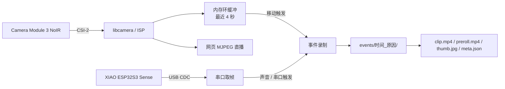

# Lookout

树莓派 5 + Camera Module 3 NoIR + XIAO ESP32S3 Sense，一套完全本地运行的事件触发双摄守夜相机。

Lookout 平时不持续写盘。主摄最近 4 秒的画面一直保存在内存环缓冲中，检测到移动或声音后，才把「事发前 + 事发后」的片段一起写入 `events/`。所以画面里出现人的那一刻不会被漏掉，也不会为了几秒钟的动静留下整晚的录像。

主摄负责清晰画面，ESP32 副摄提供广角第二机位。网页端可以看直播、手动触发、布防/撤防、切换昼夜模式；录像只留在本机，不上云。

## 特性

- **4 秒预录**：内存环缓冲持续保留事发前画面，触发后才落盘。
- **双机位**：Pi CSI 主摄 + ESP32 USB 串口副摄，事件片段同步保存。
- **本地优先**：没有云服务、账号或手机 App，浏览器直连设备。
- **昼夜自动切换**：按环境照度在彩色/黑白配置间切换，带滞回和驻留时间。
- **声音辅助触发**：ESP32 PDM 麦克风可做声音触发，默认关闭。
- **事件筛选**：用预录帧的帧差面积计算 `importance`，减少无效事件。
- **自动清理**：按时间、数量、总容量三个维度限制录像占用。
- **适合小机器**：已按 Raspberry Pi 5 2GB 调校，systemd 常驻。

## 硬件

| 部件 | 型号 / 说明 |
|---|---|
| 主机 | Raspberry Pi 5（2GB 已实测） |
| 主摄 | Camera Module 3 NoIR，CSI 排线连接 |
| 副摄 | Seeed Studio XIAO ESP32S3 Sense |
| 补光 | 850nm 红外灯板 + MOS 管驱动（可选） |
| 滤镜 | 可拆 IR-cut 滤镜（可选，白天使用） |
| 存储 | microSD 或 USB 移动硬盘，建议留足录像空间 |
| 电源 | 5V/5A USB-C 电源，避免供电不足导致相机掉线 |

两颗摄像头本身都不发光。夜间必须依赖 850nm 红外灯；没有补光时，NoIR 相机在暗处也拍不到有效画面。ESP32 与 Pi 之间请使用**支持数据传输**的 USB-C 线，充电线通常只能供电。

## 工作原理



主摄图像以 YUV420 进入处理链路，不在全图上做 RGB 转换，既少一次转换开销，也避免 RGB 路径带来的颜色偏差。

### 目录结构

```text
.
├── pi/                      # 树莓派端主程序
├── esp32/xiao_cam/          # XIAO ESP32S3 Sense 固件
├── tools/esp32_test.py      # 副摄链路测试
├── config.example.toml      # 配置模板
├── .gitattributes           # 强制 LF，避免 Windows 改过的脚本在 Pi 上报错
└── deploy.sh                # 同步到 Pi 并重启服务
```

## 快速开始

### 1. 准备树莓派

建议使用 Raspberry Pi OS Bookworm 64-bit。先确认系统能识别 CSI 相机：

```bash
dmesg | grep imx708
```

看到 `Using sensor imx708_noir for capture` 就说明驱动认到了。

也可以试 `rpicam-hello --list-cameras`，但**这条命令不一定可信**：
Raspberry Pi OS Bookworm 之后命令从 `libcamera-*` 改名成 `rpicam-*`，
而且当 `rpicam-apps` 和 `libcamera` 版本不匹配时，它会输出空的相机列表，
哪怕相机其实完全正常。以 `dmesg` 为准。

安装运行依赖：

```bash
sudo apt update
sudo apt install -y git python3-picamera2 python3-numpy python3-pil python3-serial ffmpeg rsync
```

### 2. 首次运行

```bash
git clone https://github.com/LHRRRRRRRRRRR/Raspberry_Camera_Lookout.git ~/lookout
cd ~/lookout/pi
cp ../config.example.toml config.toml
python3 main.py
```

浏览器打开 `http://raspberrypi.local:8080`，或用树莓派的局域网 IP 访问。

临时改端口、只看网页或输出调试日志：

```bash
python3 main.py --port 9000
python3 main.py --no-camera --port 9000 -v
```

`--no-camera` 不启动相机，适合调网页；`-v` 输出调试日志。

### 3. 安装为服务

确认手动运行正常后，再交给 systemd：

```bash
sudo cp vision.service /etc/systemd/system/
sudo systemctl daemon-reload
sudo systemctl enable --now vision

systemctl status vision
journalctl -u vision -f
```

如果代码不在 `/home/pi/lookout`，先修改 `vision.service` 里的 `User`、`WorkingDirectory` 和 `ExecStart`。

### 4. 烧录 ESP32 副摄

用 Arduino IDE 打开 `esp32/xiao_cam/xiao_cam.ino`，开发板选择 `XIAO_ESP32S3`，并确认：

- **PSRAM**：`OPI PSRAM`
- **USB CDC On Boot**：`Enabled`

PSRAM 选错会导致摄像头初始化失败；USB CDC 没开，Pi 收不到任何串口数据。

烧录后将板子插到 Pi 的 USB 口，确认设备节点，再单独测试副摄链路：

```bash
lsusb | grep 303a        # 应看到 303a:1001 Espressif
ls /dev/ttyACM*

cd ~/lookout
python3 tools/esp32_test.py --snap /tmp/esp32.jpg
```

能生成图片且内容正常，再把 `config.toml` 里的 `secondary.port` 指向实际设备，例如 `/dev/ttyACM0`。

### 5. 从开发机部署

`deploy.sh` 只同步运行所需的 `pi/` 目录，并重启远端服务。使用前先配置免密 SSH：

```bash
chmod +x deploy.sh
./deploy.sh
./deploy.sh pi@192.168.1.20
./deploy.sh pi@192.168.1.20 /home/pi/lookout
```

默认目标是 `pi@raspberrypi.local:/home/pi/lookout`。部署脚本会安装/更新 systemd 单元，并打印 `/status` 结果。

> Windows 上编辑过 `deploy.sh` 的话，提交前确认行尾是 LF。
> 仓库里的 `.gitattributes` 已经强制了 `eol=lf`，但如果你绕过它手改文件，
> 带到 Pi 上会报 `bad interpreter: /bin/bash^M`。

## 配置

配置文件是 `pi/config.toml`（部署后为 `/home/pi/lookout/config.toml`），从 `config.example.toml` 复制而来。修改后重启服务生效：

```bash
sudo systemctl restart vision
```

常用项：

| 配置项 | 作用 | 默认值 |
|---|---|---|
| `camera.profile` | `auto` / `day` / `night` | `auto` |
| `camera.flip` | `none` / `hflip` / `vflip` / `rot180` | `rot180` |
| `motion.area_ratio` | 变化像素占比阈值，调大可压误报 | `0.012` |
| `motion.persist` | 连续命中多少帧才触发 | `3` |
| `motion.cooldown` | 一次触发后的静默秒数 | `20.0` |
| `preroll.seconds` | 事发前保留时长 | `4.0` |
| `record.seconds` | 事发后录制时长 | `10.0` |
| `events.max_age_hours` | 事件最长保留小时数 | `24.0` |
| `events.max_count` | 最多保留事件数 | `60` |
| `events.max_gb` | 事件目录总容量上限 | `40.0` |
| `server.stream_fps` | 网页 MJPEG 推流帧率 | `5.0` |
| `secondary.enabled` | 是否启用 ESP32 副摄 | `true` |
| `sound.enabled` | 是否启用声音触发 | `false` |
| `sound.threshold` | 声音 RMS 阈值 | `800` |

### 昼夜与白平衡

`camera.profile = "auto"` 时，低于 `switch_lux[0]` 切到夜间，高于 `switch_lux[1]` 切回白天，并通过 `switch_dwell` 避免临界点反复切换。

- 没装 IR-cut 滤镜：夜间画面是黑白的，白天颜色也会偏；这是 NoIR 的物理特性。
- 装了可拆 IR-cut 滤镜：白天使用 `day` 配置，并重新标定白平衡：

```bash
cd ~/lookout/pi
# 校准要独占相机，先停服务
sudo systemctl stop vision
python3 awb_cal.py
sudo systemctl start vision
```

把测得的增益填进 `day.awb_gains`，再重启服务。留空 `[]` 则使用相机自动白平衡。

### 声音触发

声音触发默认关闭。启用前先实测安静环境和说话时的 RMS 电平。

**先停服务**，否则串口被占用，第二个句柄打不开：

```bash
sudo systemctl stop vision
python3 -c "import serial;s=serial.Serial('/dev/ttyACM0',115200,timeout=1);s.reset_input_buffer();s.write(b'STREAM 0\n');s.write(b'SND\n');print(s.readline());print(s.readline())"
```

`SND` 需要固件是带麦克风的那版。如果返回 `ERR CMD SND`，说明固件没更新；
如果 `level` 一直是 0，可能是麦克风脚位反了，串口里敲 `MIC 42 41` 再试。

把 `sound.threshold` 设在"安静"和"说话"之间，并设置 `sound.enabled = true`。

### 调参建议

- 误报多：提高 `motion.area_ratio`、`motion.persist` 和 `motion.cooldown`。
- 经常漏拍：适当降低 `motion.area_ratio` 或 `motion.threshold`。
- 夜间画面全黑：确认红外灯已开启、电源足够，并检查 `camera.profile`。
- 2GB 内存机器：保持 `preroll.size = [1280, 720]`，不要同时拉高预录尺寸和时长。
- 远程查看卡顿：把 `server.stream_fps` 降到 `1.0` 或 `2.0`，或临时设为 `0` 暂停推流。

## 网页与接口

网页看板默认在 `http://<pi>:8080`。主要接口：

| 端点 | 说明 |
|---|---|
| `GET /` | 看板：主摄/副摄直播、事件列表、控制按钮 |
| `GET /status` | 当前状态 JSON：布防、昼夜、帧率、磁盘等 |
| `GET /stream` | 主摄 MJPEG 流 |
| `GET /stream2` | ESP32 副摄 MJPEG 流 |
| `GET /snapshot.jpg` | 主摄单帧快照 |
| `GET /trigger` | 手动触发一次事件录制 |
| `GET /arm?on=1` | 布防；`on=0` 撤防 |
| `GET /profile?name=auto` | 切换昼夜模式，可选 `auto` / `day` / `night` |
| `GET /stream_fps?value=N` | 只改推流帧率，`0` 暂停推流 |
| `GET /fps?value=N` | 推流和采集一起改（网页滑块用的是这个） |
| `GET /res?preset=hd` | 切到 1080p / 15fps |
| `GET /res?preset=fast` | 切到 720p / 120fps |
| `GET /events?limit=15&min=0` | 事件列表，`min` 按重要度过滤 |
| `GET /events/<id>/...` | 读取事件文件，如 `clip.mp4`、`thumb.jpg` |

`/res` 会把选择写入 `runtime.json` 并重启服务，不修改 `config.toml`。

如果在 `[server]` 中设置了 `token`，手动触发需要带上 `?token=<token>`。

## 一次事件留下什么

```text
events/20261020-232532_motion/
├── clip.mp4          # 主摄，事后片段
├── preroll.mp4       # 主摄，事发前片段
├── preroll/          # 事发前逐帧 JPEG
├── secondary.mp4     # 副摄片段（启用时）
├── secondary/        # 副摄逐帧
├── thumb.jpg         # 缩略图
└── meta.json         # 时间、触发原因、重要度等元数据
```

`meta.json` 中的 `importance` 为 0–100。它来自预录帧之间的变化面积，只用于排序和过滤，不做目标识别：

- 抬手、挠头：通常 2–5 分
- 人走进画面：通常 20–40 分
- 搬动大件物体：通常 50 分以上

事件目录会按 `events.max_age_hours`、`events.max_count`、`events.max_gb` 自动清理。

## 常见问题

| 现象 | 排查 |
|---|---|
| 启动时报找不到相机 | `dmesg \| grep imx708` 看驱动有没有认到；检查 CSI 排线方向；必要时重启。不要只信 `rpicam-hello --list-cameras`，版本不匹配时它可能报空 |
| 网页能开但没有主摄画面 | 查看 `journalctl -u vision -f`，确认 `stream_fps` 不为 0 |
| 找不到 `/dev/ttyACM0` | 先 `lsusb \| grep 303a` 看板子是否枚举成 `303a:1001`；再 `dmesg \| grep cdc_acm`；确认 USB 线支持数据 |
| ESP32 摄像头初始化失败 | 重新确认 **OPI PSRAM** 和 **USB CDC On Boot = Enabled** |
| 日志里反复 `ESP32 无响应（PONG 超时）` | 通常是串口缓冲里堆着旧视频帧，重启服务即可；若持续发生，检查 USB 线质量 |
| 夜间什么都看不到 | 红外灯是否点亮、供电是否足够、`profile` 是否为 `night` |
| 白天颜色偏暖/发紫 | NoIR 缺少 IR-cut，装可拆滤镜并重新跑 `awb_cal.py`；或把暖光灯换成 LED |
| 开灯/关灯就触发 | 帧差对突变的照度敏感，提高 `area_ratio`，或固定室内光照 |
| 录制时 CPU 占用高 | 降低分辨率/帧率，或使用 `record.preset = "ultrafast"` |
| 服务启动失败 | 检查 `vision.service` 中的用户、工作目录和 Python 路径 |

查看服务日志：

```bash
journalctl -u vision -n 100 --no-pager
journalctl -u vision -f
```

## 已知限制

- Raspberry Pi 5 没有硬件 H.264 编码器，1080p 录制依赖 CPU 上的 libx264；4K 实时录制不现实。
- NoIR 没有红外截止片，白天在暖光灯下颜色会偏，这是物理问题，软件无法完全校正。
- 帧差法对光照突变敏感，白天开关灯可能误触发。
- 站着不动的人会逐渐融入背景模型，适合「路过」场景，不适合长时间蹲守。
- 当前只做运动/声音触发和重要度排序，不识别具体目标，也没有人脸或车牌识别。
- 网页接口是 HTTP，`token` 只做简单访问控制，不是加密。不要把 8080 端口直接暴露到公网；远程访问请走 VPN 或带 TLS 的反向代理。

## 许可

MIT
