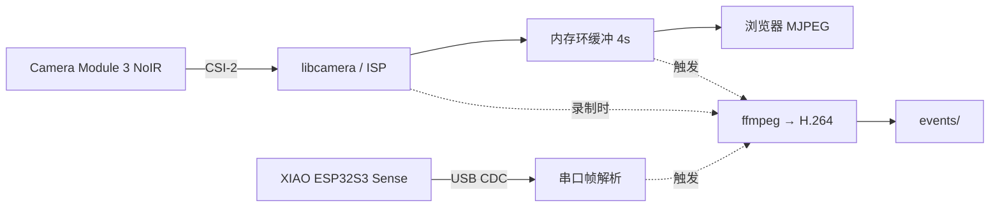

# Lookout

树莓派 5 加一颗 NoIR 摄像头，再挂一块 ESP32-S3，做成的本地录制设备。

它平时不录像。最近 4 秒的画面一直存在内存里，检测到动静才把前后一段一起写盘，
所以能拍到人进门之前那一下——这是普通监控做不到的。

两台相机：Pi 上那颗负责主画面，ESP32 那颗插在 USB 口上做广角第二机位。
全程本地，不上云。

## 依赖的硬件

| 部件 | 型号 |
|---|---|
| 主机 | Raspberry Pi 5，2GB |
| 主摄 | Camera Module 3 NoIR（无红外截止片） |
| 副摄 | XIAO ESP32S3 Sense |
| 补光 | 850nm 红外灯板 + MOS 管（可选） |
| 滤镜 | 可拆 IR-cut（可选，白天用） |

两颗摄像头都不发光。夜里全靠红外灯板，没买灯的话夜间什么都拍不到。

## 数据怎么流转



相机数据全程是 YUV420，不转 RGB。既省一次全图转换，颜色也比 RGB 输出路径准。

## 安装

Pi 这边：

```bash
sudo apt install -y python3-picamera2 python3-numpy python3-pil python3-serial ffmpeg

git clone https://github.com/LHRRRRRRRRRRR/Raspberry_Camera_Lookout.git ~/lookout
cd ~/lookout/pi
cp ../config.example.toml config.toml
python3 main.py
```

浏览器打开 `http://<pi>.local:8080`。确认能用之后装成服务：

```bash
sudo cp vision.service /etc/systemd/system/
sudo systemctl enable --now vision
```

ESP32 这边，用 Arduino IDE 打开 `esp32/xiao_cam/xiao_cam.ino`。有三个设置不能错：

- 开发板选 `XIAO_ESP32S3`
- PSRAM 选 **OPI PSRAM**，不选的话摄像头初始化直接失败
- USB CDC On Boot 选 **Enabled**，不选的话串口收不到任何数据

烧完插到 Pi 的 USB 口，`ls /dev/ttyACM0` 能看到就对了。
`python3 tools/esp32_test.py --snap /tmp/a.jpg` 可以单独测这条链路。

改完代码想同步到 Pi：

```bash
./deploy.sh                  # 默认 pi@raspberrypi.local
./deploy.sh pi@192.168.1.20
```

需要先配好免密 ssh。

## 配置

`config.toml` 里每段都有注释，常用的几个：

| 键 | 作用 | 默认 |
|---|---|---|
| `motion.area_ratio` | 变化像素占比，调大能压误报 | 0.012 |
| `preroll.seconds` | 事前留几秒 | 4.0 |
| `record.seconds` | 事后录几秒 | 10.0 |
| `events.max_age_hours` | 录下来的东西留多久 | 24 |
| `server.stream_fps` | 网页推流帧率，直接决定带宽 | 5.0 |
| `sound.threshold` | 声音触发阈值，0 是关闭 | 0 |

这个文件不会进仓库，里面的 IP 和路径都是你自己的。

## 网页上的接口

| 端点 | 说明 |
|---|---|
| `GET /` | 看板，两个画面并排 |
| `GET /status` | JSON 状态 |
| `GET /stream`、`/stream2` | 主摄 / 副摄 MJPEG 流 |
| `GET /snapshot.jpg` | 主摄单帧 |
| `GET /trigger` | 手动录一段 |
| `GET /arm?on=1` | 布防或撤防 |
| `GET /fps?value=N` | 帧率，填 0 就暂停推流、不耗流量 |
| `GET /res?preset=hd\|fast` | 1080p/15fps 或 720p/120fps，会重启服务 |
| `GET /events?limit=&min=` | 事件列表，`min` 按重要度过滤 |

## 一次录制留下的东西

```
events/20261020-232532_motion/
├── clip.mp4        主摄，事后 10 秒
├── preroll.mp4     主摄，事前 4 秒
├── preroll/        事前逐帧 JPEG
├── secondary.mp4   副摄片段
├── secondary/      副摄逐帧
├── thumb.jpg       缩略图，取预录中间那一帧
└── meta.json       元数据
```

`meta.json` 里有个 `importance` 字段，0 到 100。算法很简单：拿预录的几十张帧做相邻帧差，
取变化面积最大的那一帧。抬手挠头大概 2 到 5 分，人走进画面 20 到 40 分，
搬东西 50 分以上。不识别是什么，但能把大部分噪音挡在列表外面。

## 已知限制

- Pi 5 没有硬件 H.264 编码器，1080p 录制靠 CPU 跑 libx264，4K 不用想。
- NoIR 没有红外截止片，白天在暖光灯下颜色会偏，这是物理问题，软件调不回来。
  要么装可拆滤镜，要么把灯换成 LED。
- 帧差法对光照突变敏感，白天开灯关灯会误触发。
- 站着不动的人会慢慢融进背景（背景模型每帧更新 3%），对"路过"场景合适，对"蹲守"不合适。

## 许可

MIT
