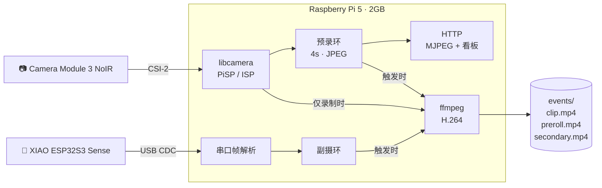

<div align="center">

# 👁 Lookout

**一台会「等」的本地视觉哨兵**

不 7×24 录像 —— 平时只观察，<br>
只在对的那一刻，把**事前 4 秒 + 事后 10 秒**、两台相机的画面一起留下。

<sub>全程本地 · 不上云 · 不联网 · 不发通知给任何第三方</sub>

<br>


</div>

---

## 💡 它为什么不一样

大多数监控是"不停地录，事后翻几百个片段"。这套反过来：

> **内存里一直滚着最近 4 秒。** 检测到动静才落盘——所以它拍得到**人踏进门之前的那一秒**。

「事前」这一段叫 *preroll*，是整套东西的灵魂。没有它，你只能拍到"人已经走过去"。

---

## ✨ 能力

| | 能力 | 说明 |
|---|---|---|
| 🎬 | **双机位同步** | 主摄 1080p + ESP32 广角 640×480，时间戳对齐 |
| ⏪ | **4 秒预录** | 内存环形缓冲，事发前的画面不丢 |
| 🎯 | **重要度评分** | 用预录帧做帧差算 0~100 分，**过滤掉八成噪音** |
| 🌗 | **日夜自切** | 低于阈值自动转黑白（红外夜视本来就没颜色） |
| 📱 | **网页看板** | 双路 MJPEG、帧率滑块、事件缩略图、一键触发 |
| 🗑 | **自动清理** | 按数量 / 体积 / 时长三重上限滚动删除 |
| 🔌 | **USB 直连** | ESP32 插在 Pi 上，供电+数据一根线，不用配网 |
| 🛡 | **故障自愈** | systemd 常驻，崩溃重启，串口断线自动重连 |

---

## 🧩 架构



**关键设计**：相机数据全程走 **YUV420**，不转 RGB——省一次全图转换，色彩也更准（见 [PITFALLS #2](docs/PITFALLS.md)）。

---

## 🔧 硬件

| 部件 | 型号 | 说明 |
|---|---|---|
| 主机 | **Raspberry Pi 5 / 2GB** | 大脑；无硬件编码器，H.264 靠 CPU |
| 主摄 | **Camera Module 3 NoIR** | 12MP，能收红外；**没有 IR-cut，白天偏色** |
| 副摄 | **XIAO ESP32S3 Sense** | 广角 + PDM 麦克风 + 补光灯 GPIO |
| 补光 | 850nm 灯板 + MOS 管 | *可选*。**没有它，夜里等于瞎** |
| 滤镜 | 可拆 IR-cut 滤片 | *可选*。白天颜色正常，夜里要拆 |

---

## 🚀 快速开始

<details>
<summary><b>① Pi 端</b>（点击展开）</summary>

```bash
sudo apt update
sudo apt install -y python3-picamera2 python3-numpy python3-pil python3-serial ffmpeg

git clone https://github.com/LHRRRRRRRRRRR/Raspberry_Camera_Lookout.git ~/lookout
cd ~/lookout/pi
cp ../config.example.toml config.toml     # 按需修改
python3 main.py                            # 先前台跑，看清日志
```

跑通后装成服务：

```bash
sudo cp vision.service /etc/systemd/system/
sudo systemctl enable --now vision
```

打开 `http://<pi>.local:8080`

</details>

<details>
<summary><b>② ESP32 固件</b>（点击展开）</summary>

用 Arduino IDE 打开 `esp32/xiao_cam/xiao_cam.ino`：

| 选项 | 值 |
|---|---|
| Board | `XIAO_ESP32S3` |
| PSRAM | **OPI PSRAM** ← 不开摄像头必挂 |
| Flash Size | 8MB |
| USB CDC On Boot | **Enabled** ← 不开串口收不到任何数据 |

烧完插到 Pi 的 USB 口，`ls /dev/ttyACM0` 应该出现。

自检：

```bash
python3 tools/esp32_test.py --snap /tmp/a.jpg --lamp 2000
```

</details>

<details>
<summary><b>③ 一键部署</b>（点击展开）</summary>

配好免密 ssh 之后：

```bash
./deploy.sh                          # 默认 pi@raspberrypi.local
./deploy.sh pi@192.168.1.20          # 指定主机
```

它会 rsync 代码、装服务、重启、回显状态。

</details>

---

## ⚙️ 配置

`config.toml` 每段都有中文注释。最常改的几个：

| 键 | 作用 | 默认 |
|---|---|---|
| `motion.area_ratio` | 变化像素占比，**调大压误报** | `0.012` |
| `preroll.seconds` | 事前留几秒 | `4.0` |
| `record.seconds` | 事后录几秒 | `10.0` |
| `events.max_age_hours` | 过期自动删 | `24` |
| `server.stream_fps` | MJPEG 帧率，**直接决定带宽** | `5.0` |
| `sound.threshold` | 声音触发，`0` = 关闭 | `0` |

> ⚠️ `config.toml` 已被 `.gitignore` 排除——你的 IP、路径、端口不会进仓库。

---

## 🌐 HTTP 接口

| 端点 | 说明 |
|---|---|
| `GET /` | 网页看板 |
| `GET /status` | JSON 状态 |
| `GET /stream` `/stream2` | 主摄 / 副摄 MJPEG |
| `GET /snapshot.jpg` | 主摄单帧 |
| `GET /trigger` | 手动触发一次录制 |
| `GET /arm?on=1` | 布防 / 撤防 |
| `GET /profile?name=day\|night\|auto` | 日/夜配置 |
| `GET /fps?value=N` | 帧率（`0` = 暂停推流，零带宽） |
| `GET /res?preset=hd\|fast` | 1080p/15fps 或 720p/120fps |
| `GET /events?limit=&min=` | 事件列表（`min` = 重要度过滤） |

---

## 📂 一次事件的产物

```text
events/20261020-232532_motion/
├── clip.mp4          # 主摄 · 事后 10s · 全分辨率
├── preroll.mp4       # 主摄 · 事前 4s · 低清
├── preroll/          # 事前逐帧 JPEG（用于算重要度）
├── secondary.mp4     # 副摄 · 同步片段
├── secondary/        # 副摄逐帧
├── thumb.jpg         # 缩略图（预录中间帧）
└── meta.json         # 元数据 + 重要度分数
```

**重要度**用预录帧做帧差算出来：

| 场景 | 分数 |
|---|---|
| 抬手挠头 | 2 ~ 5 |
| 人走进画面 | 20 ~ 40 |
| 搬东西 | 50 ~ 100 |

---

## 🕳 踩过的坑

调试过程中撞出来的 10 个问题，每个都写了**现象 / 根因 / 修法**：

👉 **[docs/PITFALLS.md](docs/PITFALLS.md)**

剧透几个：

- 不写 `format` 时 `main` 流默认 4 字节/像素，喂给 `yuv420p` 的 ffmpeg 会整帧错位 → 10 秒录出 449MB
- `RGB888` 输出路径和 `YUV420` 色彩不一致（木头会变灰蓝）
- ESP32 重连时要先发 `STREAM 0`，否则握手读到的是旧视频流
- 信号处理函数里调 `srv.shutdown()` 会死锁

---

<div align="center">
<sub>MIT License · 用 Raspberry Pi + ESP32 搭的，跑在自己房间里的东西</sub>
</div>
